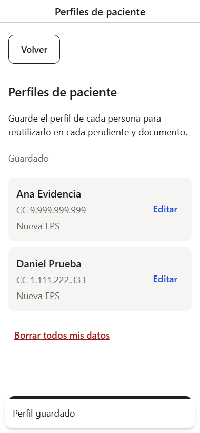
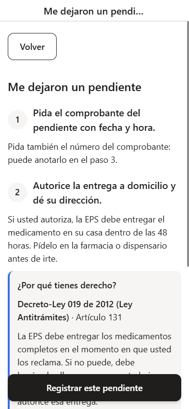
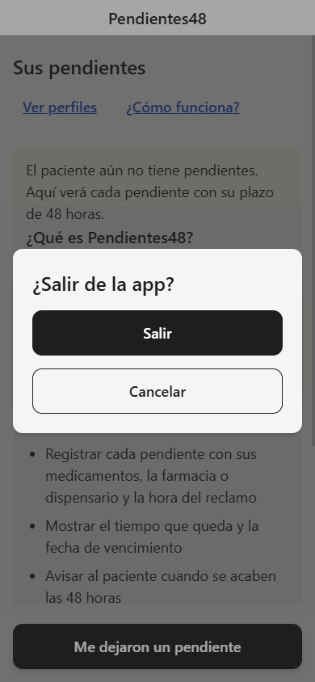
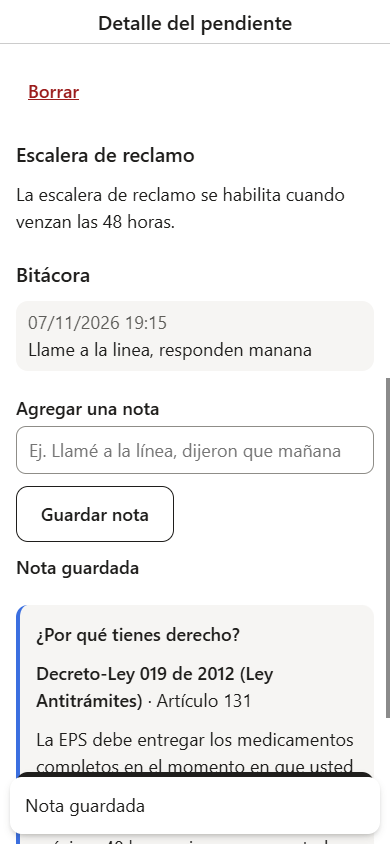
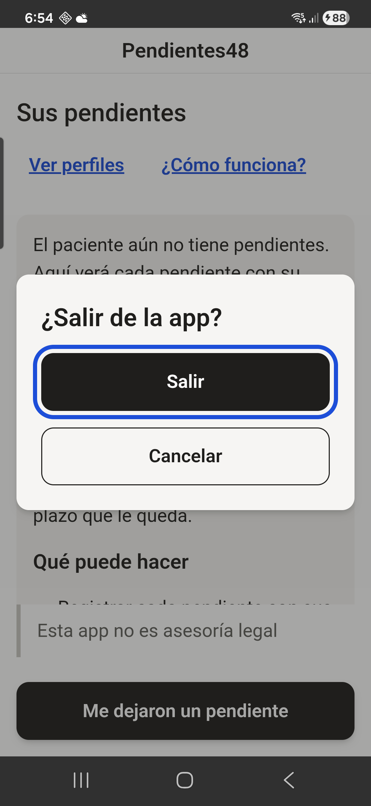

# Pendientes48

> Tu medicamento en 48 horas, con la ley de tu lado.

## Demo en vivo

**[pendientes48.pendientes48.workers.dev](https://pendientes48.pendientes48.workers.dev)** — funciona en
cualquier navegador. En Android, Chrome ofrece **Instalar aplicación** desde la misma URL: queda con
ícono propio y se abre a pantalla completa, sin barra del navegador.

> 🔜 **Muy pronto en tiendas de aplicaciones:** en una fase cercana la app estará disponible en
> Google Play (y otras tiendas) para descargarla e instalarla directamente en el celular.

## Capturas

| | |
|---|---|
|  |  |
| *Confirmación al guardar + botón "Volver"* | *Guía de ventanilla con la norma visible* |
|  |  |
| *Salida confirmada desde la raíz* | *Detalle con bitácora y aviso* |



Este README es la referencia para personas. El contexto que leen los agentes de IA está en
`openspec/config.yaml` (resumen de este archivo). Si cambias uno, actualiza el otro.

## Propósito
Ayudar a pacientes colombianos (o a quien hace el trámite por ellos) cuando la farmacia de la EPS
no entrega un medicamento completo y queda "pendiente". La app:
1. Guía al paciente en la ventanilla para que su derecho quede activado.
2. Cuenta las 48 horas legales desde la hora del reclamo.
3. Si se vencen, genera la queja con la norma como soporte visible (EPS → Supersalud).

## Usuario objetivo
- Pacientes crónicos y adultos mayores, muchas veces con baja alfabetización digital.
- Familiares que gestionan los trámites de otra persona.

## Cómo se construyó
- **Spec-driven (OpenSpec):** cada tarea nace como un cambio con propuesta, diseño, tareas y
  escenarios; la especificación es el contrato y los gates la validan antes de cada PR.
- **Flujo multiagente:** un planificador detecta ambigüedades, un implementador ejecuta sin
  re-planificar y un verificador con ojos frescos (sesión aparte) solo detecta. Las decisiones de
  alcance, texto legal y dependencias siempre las toma el humano.
- **Gates antes de cada PR:** type-check, 363 pruebas unitarias, validador estricto de la
  especificación y build con presupuesto de tamaño (< 550 kB; actual 478 kB).
- **Verificación en dispositivo real:** matriz de retroceso del botón de Android, toasts y
  capturas en un Galaxy S22, además de la evidencia a 390 px y 1280 px.

## Stack
- Ionic (última versión estable) + Angular (standalone, Signals, zoneless) + Capacitor
- Plataformas: Android (Capacitor) y PWA (mismo código)
- Persistencia: IndexedDB vía `idb-keyval` (un solo camino para Android y web)
- PDF: `pdfmake` (generado en el dispositivo) + `@types/pdfmake` (tipos para `domain/`)
- Plugins: `@capacitor/app`, `@capacitor/local-notifications`, `@capacitor/camera` +
  `@ionic/pwa-elements`, `@capacitor/clipboard`, `@capacitor/share`, `@capacitor/filesystem`
- Despliegue: Cloudflare (Workers/Pages con `wrangler`) + service worker de Angular
- Pruebas: unitarias en servicios de dominio (plazos, plantillas)
- Íconos y splash: `@capacitor/assets` (devDependency) a partir de `assets/` (`design.md` D17)

## Convenciones
- Archivos sin sufijo `.component` (convención Angular 22)
- Componentes standalone, Signals para estado, zoneless change detection
- `provideAppInitializer()` para inicialización asíncrona
- Carpetas por concepto: `domain/` (TypeScript puro), `data/`, `platform/` (único que usa
  Capacitor), `features/` y `shared/`; imports entre capas con alias `@domain/*`, `@data/*`,
  `@platform/*`, `@shared/*`; una feature nunca importa de otra (lo compartido va a `shared/`).
  Detalle y reglas en `design.md` (D11 y D12)
- Sistema de diseño minimalista tipo documento (`design.md` D14–D16): tokens en `src/theme/`,
  guía de estilo en `/guia` (solo en desarrollo)
- Decisiones de arquitectura documentadas en `design.md` en el momento en que se toman

## Herramientas de IA (solo fuentes oficiales o verificadas)
| Herramienta | Publicador | Uso en este proyecto |
|---|---|---|
| OpenSpec CLI (`@fission-ai/openspec`) | Fission-AI (MIT) | Flujo spec-driven: `/opsx:propose`, `/opsx:apply`, `/opsx:archive` |
| Angular Agent Skills (`angular/skills`) | Equipo de Angular (Google) | Guía de código Angular actualizada: Signals, testing, accesibilidad |
| Angular CLI MCP (`ng mcp`) | Equipo de Angular (Google) | Mejores prácticas por versión, búsqueda en angular.dev; arranca en `--read-only` |
| Context7 MCP (`@upstash/context7-mcp`) | Upstash | Documentación actual de Ionic, Capacitor, pdfmake e idb-keyval |
| GitHub MCP (remoto) | GitHub | Pull requests e issues del repositorio; configurado en alcance local, nunca en `.mcp.json` |
| Playwright MCP (`@playwright/mcp`) | Microsoft | Opcional, solo en el bloque 4 para probar flujos de la PWA |

Regla: si una guía de una herramienta contradice este README o `openspec/config.yaml`, mandan estos archivos.

## Flujo de trabajo con Git
- `main` siempre estable; una rama por tarea: `feat/<n.°-tarea>-<nombre>` (ej. `feat/1.1-plazo`)
- Para tareas sin número (setup, documentación, tooling): `chore/<nombre>` o `docs/<nombre>`
  (ej. `docs/opsx-qa-command`)
- Commits con Conventional Commits en ingles: `feat: calculate expiration of 48 h`
- Al terminar una tarea: push de la rama → pull request → revisión → merge a `main`
- Secretos (tokens, `.env`) nunca se suben; `.env.example` sí

## Desarrollo local
```bash
npm install
npm start        # dev server en http://localhost:4200
npm test         # pruebas unitarias (Vitest)
npm run build    # build de producción con service worker
npm run deploy   # despliegue a Cloudflare con wrangler
```

## Restricciones (no negociables)
- **Local-first:** sin backend, sin login, sin envío de datos a terceros. Los datos de salud
  son datos sensibles (Ley 1581 de 2012).
- **No es asesoría legal:** aviso visible en la app y en cada PDF; también en la pantalla
  donde se copia el texto corto.
- **Normas como datos:** el contenido legal vive en `normas.json`, `plantillas` y las constantes
  aprobadas de `domain/` (p. ej. `AVISO_NO_ASESORIA`), nunca hardcodeado en componentes: las
  pantallas lo inyectan por input.
- **Accesibilidad:** texto base ≥ 18px, botones grandes, una acción principal por pantalla.

## Glosario de dominio
- **Pendiente:** medicamento que la farmacia no entregó completo al momento del reclamo.
- **Hora de reclamo:** momento en que el afiliado reclama en la farmacia; inicia el plazo de 48 h.
- **Comprobante de pendiente:** papel/registro que entrega la farmacia con lo que quedó debiendo.
- **Gestor farmacéutico:** operador que dispensa medicamentos por cuenta de la EPS.
- **Red alterna:** otros gestores o IPS donde se puede reclamar si no se cumple el plazo.
- **PQRD:** Peticiones, Quejas, Reclamos y Denuncias.
- **Escalera de reclamo:** paso 1 queja ante la EPS; paso 2 queja ante la Supersalud.

## Créditos
Desarrollado por [10carabal](https://github.com/10carabal).
